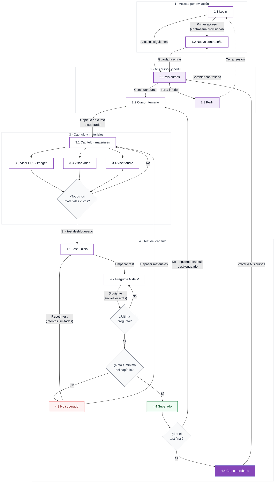

# Pantallas

Comportamiento previsto de cada pantalla del flujo del alumno. La numeración coincide con la de los
mockups en Claude Design (https://claude.ai/artifact/LVgAGm6TCGkMxiEMvK14vW). Las reglas que se
citan están justificadas en [decisiones.md](decisiones.md).

## Mapa del flujo

**Leyenda:** morado claro = pantallas raíz con barra inferior · blanco = pantallas de detalle ·
gris = decisiones del sistema · rojo/verde = resultado del test · morado sólido = fin del curso ·
línea discontinua = acciones secundarias desde Perfil.

---

## 1 · Acceso por invitación

### 1.1 Login

**Objetivo:** entrar con las credenciales recibidas en la invitación.

- **Contenido:** cabecera con el degradado de marca y el mensaje de la app; campos *Email* y *Contraseña* (con botón para mostrarla); botón **Entrar**; enlace «Contacta con tu coordinadora»; selector de idioma (ES) arriba a la derecha.
- **Acciones:**
  - *Entrar* → valida las credenciales. Si es el primer acceso (contraseña provisional) → 1.2; si no → 2.1.
  - *Idioma* → cambia el idioma de la interfaz antes de entrar.
- **Estados:** error de credenciales (alerta bajo el formulario, sin indicar cuál de los dos campos falla); cargando (botón deshabilitado con indicador); usuario desactivado.
- **shadcn:** `Input`, `Label`, `Button`, `Select` / `DropdownMenu` (idioma), `Alert`.

### 1.2 Primer acceso · nueva contraseña

**Objetivo:** sustituir la contraseña provisional por una propia. Es obligatorio y no se puede saltar.

- **Contenido:** saludo con el nombre; *Nueva contraseña* y *Repite la contraseña*; lista de requisitos que se marcan en vivo (8 caracteres, mayúscula y número, coinciden).
- **Acciones:** *Guardar y entrar* → guarda la contraseña, marca al usuario como activado y lleva a 2.1. Solo se activa cuando se cumplen todos los requisitos.
- **Estados:** requisitos cumplidos o pendientes; error del servidor al guardar.
- **Reutilización:** desde Perfil («Cambiar contraseña») se usa la misma pantalla, pidiendo además la contraseña actual.
- **shadcn:** `Form` (react-hook-form + zod), `Input`, `Label`, `Button`.

---

## 2 · Mis cursos y perfil

### 2.1 Mis cursos (inicio)

**Objetivo:** ver los cursos asignados y retomar el que está en curso con un toque.

- **Contenido:**
  - Título «Mis cursos» y avatar con iniciales (lleva a Perfil).
  - Sección **En curso · N**: una tarjeta por curso con formación, nombre del curso, descripción, progreso («1 de 6 superados» + barra), siguiente paso pendiente y botón **Continuar curso**.
  - Sección **Aprobados · N**: cursos terminados; vacía muestra «Cuando apruebes un curso aparecerá aquí».
  - Barra inferior (*Mis cursos* activo, *Perfil*).
- **Acciones:** *Continuar curso* / tocar la tarjeta → 2.2.
- **Estados:** sin cursos asignados (mensaje indicando que Staff le asignará formación); cargando (esqueleto de tarjeta); curso aprobado (tarjeta en la sección Aprobados con la nota).
- **Cálculo del progreso:** pasos superados / pasos totales, donde cada capítulo y el test final cuentan como un paso.
- **shadcn:** `Card`, `Progress`, `Button`, `Avatar`, `Badge`.

### 2.2 Curso · temario

**Objetivo:** entender el curso y ver en qué punto del temario está el alumno.

- **Contenido:** formación, nombre, descripción completa, progreso del curso y la lista **Temario** en forma de pasos:
  - **Superado:** check verde y etiqueta «Superado · nota».
  - **En curso:** número en morado, tarjeta resaltada y «En curso · X de Y materiales vistos».
  - **Bloqueado:** candado gris y «Se abre al superar el capítulo N».
  - **Test final del curso:** último paso, «15 preguntas · se abre al superar los N capítulos».
  - Cada capítulo muestra nº de materiales, nº de preguntas y nota mínima.
- **Acciones:** tocar un capítulo superado o en curso → 3.1. Los capítulos bloqueados no son pulsables.
- **Reglas:** solo un capítulo puede estar «en curso» a la vez; los superados se pueden volver a consultar.
- **shadcn:** `Progress`, `Badge`, `Card`; el stepper es un componente propio.

### 2.3 Perfil

**Objetivo:** datos mínimos de la cuenta y ajustes.

- **Contenido:** avatar con iniciales, nombre y email; resumen *Cursos asignados* / *Cursos aprobados*; **Mis datos** (nombre y apellidos, email, solo lectura porque los gestiona Staff); **Ajustes** (Cambiar contraseña, Idioma); **Cerrar sesión**.
- **Acciones:** *Cambiar contraseña* → 1.2 (variante con la contraseña actual); *Idioma* → selector; *Cerrar sesión* → confirma y vuelve a 1.1.
- **shadcn:** `Avatar`, `Card`, `Separator`, `Select` / `Sheet` (idioma), `AlertDialog` (cerrar sesión), `Button`.

---

## 3 · Capítulo y materiales

### 3.1 Capítulo · materiales

**Objetivo:** estudiar los materiales del capítulo y llegar al test.

- **Contenido:**
  - Cabecera «Curso · Capítulo N de M», título del capítulo e instrucción.
  - **Materiales** («X de Y vistos»): una fila por material con icono de tipo, título, tipo y peso o duración, y el estado *Visto* o *Pendiente*. Botón de descarga a la derecha.
  - Tarjeta **Test del capítulo**: nº de preguntas, nota mínima y aciertos necesarios, barra de materiales vistos y botón.
- **Acciones:** tocar un material → su visor (3.2, 3.3 o 3.4); *Descargar* → descarga el archivo original; *Hacer el test* → 4.1.
- **Estados del test:**
  - **Bloqueado:** quedan materiales sin ver; el botón está deshabilitado e indica «Abre los N materiales pendientes».
  - **Disponible:** botón «Hacer el test».
  - **Superado:** muestra la nota y permite repasar los materiales; repetir el test es opcional (pendiente de decidir).
- **Tipos de material:** PDF, imagen, vídeo y audio.
- **shadcn:** `Card`, `Button`, `Badge`, `Progress`.

### 3.2 Visor · PDF (e imagen)

**Objetivo:** leer el documento sin salir de la app.

- **Contenido:** cabecera con *Cerrar*, título, tipo y nº de páginas, y *Descargar*; páginas del PDF en scroll; barra inferior con página anterior/siguiente («3 / 12») y zoom.
- **Imagen:** misma pantalla sin paginación, con zoom por gesto (pinch).
- **Marca de visto:** al abrir el material.
- **shadcn:** `Button`; renderizado con un visor de PDF (p. ej. `react-pdf` / pdf.js).

### 3.3 Visor · vídeo

**Objetivo:** ver el vídeo del capítulo.

- **Contenido:** cabecera «Material N de M» con *Cerrar* y *Descargar*; reproductor 16:9 con play/pausa, barra de posición y tiempo; título, duración y descripción; aviso «Se marcará como visto cuando llegues al final»; botón **Siguiente material**.
- **Marca de visto:** al reproducir hasta el final.
- **shadcn:** `Slider` (posición), `Button`, `Alert`.

### 3.4 Visor · audio

**Objetivo:** escuchar el audio del capítulo.

- **Contenido:** portada plana en color de marca con el título; tiempo y barra de posición; controles *retroceder 15 s*, *play/pausa*, *velocidad (1×, 1,5×, 2×)*.
- **Al terminar el último material pendiente:** aviso verde «Has revisado los N materiales» y botón **Ir al test del capítulo** (→ 4.1).
- **Marca de visto:** al reproducir hasta el final.
- **shadcn:** `Slider`, `Button`, `Alert`.

---

## 4 · Test del capítulo

### 4.1 Test · inicio

**Objetivo:** que el alumno sepa las condiciones antes de empezar.

- **Contenido:** título y nombre del capítulo; datos clave (*Preguntas*, *Para superarlo: 80 % · 4 aciertos*, *Intentos: ilimitados*, *Tiempo: sin límite*); reglas («4 respuestas, solo una correcta», «no podrás volver atrás», «verás las falladas con la explicación»); historial de intentos («Es tu primer intento» o «Último intento: 60 %»).
- **Acciones:** *Empezar test* → 4.2; *Volver* → 3.1.
- **Cálculo:** aciertos necesarios = ⌈nº de preguntas × nota mínima⌉.
- **shadcn:** `Card`, `Button`.

### 4.2 Test · pregunta

**Objetivo:** responder una pregunta cada vez.

- **Contenido:** *Salir* (X), «Pregunta N de M», barra segmentada de progreso, enunciado y 4 respuestas seleccionables (radio), con una sola seleccionada.
- **Acciones:**
  - Seleccionar una respuesta → activa **Siguiente pregunta** (en la última, **Ver resultado**).
  - *Siguiente* → guarda la respuesta y avanza; no hay «Anterior».
  - *Salir* → confirma que se perderá el intento y vuelve a 3.1.
- **Reglas:** no se muestra si la respuesta es correcta hasta el final; el orden de las respuestas se mezcla en cada intento.
- **shadcn:** `RadioGroup` + `Label` (dentro de `fieldset` / `legend`), `Progress`, `Button`, `AlertDialog` (salir).

### 4.3 Resultado · no superado

**Objetivo:** mostrar la nota y explicar los errores para que el alumno aprenda y repita.

- **Contenido:**
  - Etiqueta **No superado**, porcentaje grande, «X de N correctas» y barra con marca de la nota mínima.
  - Texto con la nota necesaria.
  - **Preguntas falladas · K**: por cada una, el enunciado, *Tu respuesta* (rojo), *Respuesta correcta* (verde) y la explicación.
  - **Preguntas acertadas · J**: plegadas (acordeón).
- **Acciones:** *Repasar materiales* → 3.1; *Repetir test* → 4.1 (sin espera).
- **shadcn:** `Badge`, `Progress`, `Card`, `Accordion`, `Button`.

### 4.4 Resultado · superado

**Objetivo:** confirmar el aprobado y llevar al siguiente paso.

- **Contenido:** etiqueta **Capítulo superado**, porcentaje, aciertos, barra con la nota mínima y el intento en que se superó; tarjeta **Siguiente capítulo desbloqueado**; progreso actualizado del curso.
- **Acciones:** *Empezar capítulo N+1* → 3.1 del siguiente capítulo; *Volver al temario* → 2.2.
- **Variante:** si era el último capítulo, la tarjeta presenta el **Test final del curso**.
- **Pendiente:** decidir si aquí también se muestran las falladas cuando se aprueba sin el 100 %. Propuesta: sí, plegadas.
- **shadcn:** `Badge`, `Progress`, `Card`, `Button`.

### 4.5 Curso aprobado

**Objetivo:** cerrar la formación. Staff queda informado de que el alumno la ha completado y superado.

- **Contenido:** cabecera con el degradado de marca, «Has aprobado el curso», nombre del curso y formación; nota del test final y capítulos superados; texto confirmando que Staff tiene el registro. Sin certificado.
- **Acciones:** *Volver a Mis cursos* → 2.1 (el curso pasa a *Aprobados*); *Ver materiales del curso* → 2.2 en modo consulta.
- **shadcn:** `Card`, `Button`.

---

## Datos que necesita el frontend (resumen)

| Entidad | Campos usados en pantalla |
| --- | --- |
| Usuario | nombre, apellidos, email, idioma, `mustChangePassword` |
| Formación | nombre |
| Curso | nombre, descripción, capítulos, test final, progreso del alumno, estado (en curso / aprobado), nota final |
| Capítulo | orden, título, nota mínima (%), nº de preguntas, materiales, estado (bloqueado / en curso / superado), mejor nota, nº de intentos |
| Material | tipo (pdf / imagen / vídeo / audio), título, tamaño o duración, nº de páginas, URL de visualización y descarga, visto (sí/no) |
| Pregunta | enunciado, 4 respuestas, índice de la correcta, explicación |
| Intento | capítulo, fecha, respuestas elegidas, aciertos, porcentaje, superado (sí/no) |
